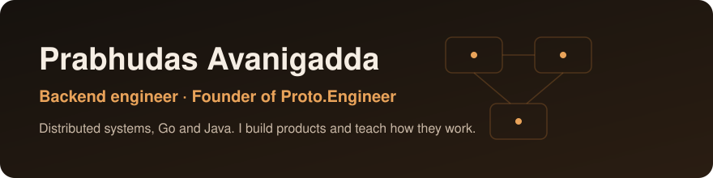

  

  

## About me

I build backends that stay correct when the traffic, the failures and the money are real.

- **Founder of [MoveTara](https://www.movetara.com).** The brain for running a PG or accommodation business: rent, bookings, payments, KYC and staff in one system.
- **Founder of Tatvata.** A creator identity and brand partnership platform.
- **Founder of [Proto.Engineer](https://www.proto-engineer.com).** Engineering courses in system design, DSA, backend and low-level design.
- **Builder of [protolift](https://github.com/Prabhudas111/protolift).** An open-source Go CLI that runs your dev stack in your own AWS or Google Cloud account and serves it on localhost.
- **B.Tech in Computer Science, NIT Silchar.** 1400+ DSA problems solved.

## Backend, end to end

| Layer | What I build |
|---|---|
| **Services** | Go and Java (Spring Boot). Modular monoliths and microservices with clear boundaries, versioned REST APIs, OpenAPI contracts. |
| **Data** | PostgreSQL schema design, safe migrations, transactions, row-level security, reconciliation jobs. |
| **Distributed systems** | Fan-out and aggregation, Kafka pipelines, idempotent webhooks, retries with timeouts, deduplication. |
| **Money and identity** | Payment gateway integration, phone OTP login, JWT sessions, KYC, access control driven by data. |
| **Cloud and delivery** | AWS and GCP, Docker, Kubernetes, CI/CD, blue-green releases with rollback. |
| **Reliability** | Logs, metrics and alerts, production debugging, cost control. |

I like hard backend problems. If you have one, write to me.

## Tools I work with

  &nbsp;
  &nbsp;
  &nbsp;
  &nbsp;
  &nbsp;
  &nbsp;
  &nbsp;
  &nbsp;
  &nbsp;
  &nbsp;
  

## Connect

[LinkedIn](https://www.linkedin.com/in/prabhudas-avanigadda-338920164) · [Proto.Engineer](https://www.proto-engineer.com) · [YouTube](https://www.youtube.com/@Proto.Engineer) · [Instagram](https://www.instagram.com/proto.engineer/) · Email: prabhudasavanigadda9866@gmail.com
